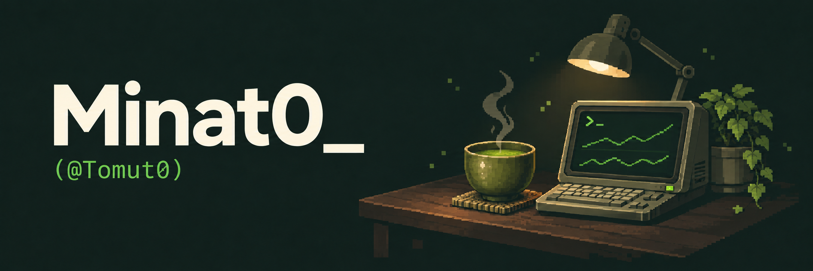

# Linux infrastructure & backend development

I’m Evgeny, a systems administrator and backend developer. I work on game hosting, from the physical servers and network to the platform customers use to launch and manage their servers.

## Currently building [mikasa.host](https://mikasa.host/)

I develop a game hosting platform with its own server infrastructure in Russia and abroad. It hosts Minecraft, Garry's Mod, and other multiplayer games.

- **Infrastructure.** I administer physical Linux servers, configure MikroTik networks, automate server setup with Ansible, and monitor services with Zabbix and Uptime Kuma.
- **Backend.** I designed the modular payment system that handles multiple providers. I also build external API integrations, automate service provisioning, and run background jobs through Laravel Queue.
- **Delivery.** I set up GitHub Actions pipelines that run tests, build Docker images, publish them to Harbor, and deploy the platform. The application uses PHP, Laravel, Vue, Inertia, Redis, and MariaDB.

## Open source

**[SimpleClans](https://github.com/RoinujNosde/SimpleClans)** · Collaborator on a Minecraft clan plugin. My contributions include [Java 21 build support](https://github.com/RoinujNosde/SimpleClans/pull/446), [a database migration fix](https://github.com/RoinujNosde/SimpleClans/pull/456), and [Discord integration fixes](https://github.com/RoinujNosde/SimpleClans/pull/438). [600+ servers · 1,000+ players on bStats](https://bstats.org/plugin/bukkit/SimpleClans/7131).

**[SimpleClansStats](https://github.com/Tomut0/SimpleClansStats)** · My Go and SvelteKit dashboard for tracking clans, players, and activity across Minecraft servers.

I also built [SCDenizenBridge](https://github.com/Tomut0/SCDenizenBridge), which lets server admins use SimpleClans from Denizen scripts.

---

# Linux-инфраструктура и бэкенд-разработка

Я Евгений, системный администратор и бэкенд-разработчик. Работаю над игровым хостингом, от физических серверов и сети до платформы, через которую пользователи запускают свои серверы и управляют ими.

## Сейчас развиваю [mikasa.host](https://mikasa.host/)

Это платформа игрового хостинга с собственной серверной инфраструктурой в России и за рубежом. На ней можно запустить серверы Minecraft, Garry's Mod и других многопользовательских игр.

- **Инфраструктура.** Администрирую физические Linux-серверы, настраиваю сети на MikroTik, автоматизирую конфигурацию через Ansible и слежу за работой сервисов в Zabbix и Uptime Kuma.
- **Бэкенд.** Спроектировал модульную платёжную систему с несколькими провайдерами. Интегрирую внешние API, автоматизирую выдачу услуг и запускаю фоновые задачи через Laravel Queue.
- **Доставка кода.** Настроил пайплайны GitHub Actions для тестирования, сборки Docker-образов, публикации в Harbor и развёртывания платформы. Приложение работает на PHP, Laravel, Vue, Inertia, Redis и MariaDB.

## Проекты с открытым кодом

**[SimpleClans](https://github.com/RoinujNosde/SimpleClans)** · Участвую в разработке плагина кланов для Minecraft как collaborator. Добавил [поддержку сборки на Java 21](https://github.com/RoinujNosde/SimpleClans/pull/446), [исправил миграцию базы](https://github.com/RoinujNosde/SimpleClans/pull/456) и [доработал интеграцию с Discord](https://github.com/RoinujNosde/SimpleClans/pull/438). [600+ серверов · 1 000+ игроков по данным bStats](https://bstats.org/plugin/bukkit/SimpleClans/7131).

**[SimpleClansStats](https://github.com/Tomut0/SimpleClansStats)** · Моя панель на Go и SvelteKit для просмотра данных о кланах, игроках и событиях на нескольких серверах Minecraft.

Также разработал [SCDenizenBridge](https://github.com/Tomut0/SCDenizenBridge), который позволяет использовать SimpleClans в скриптах Denizen.
